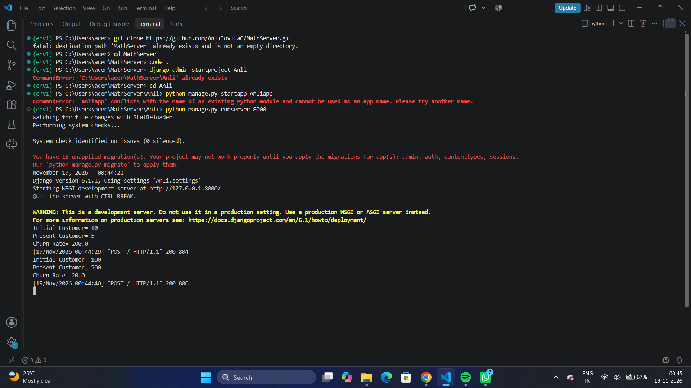
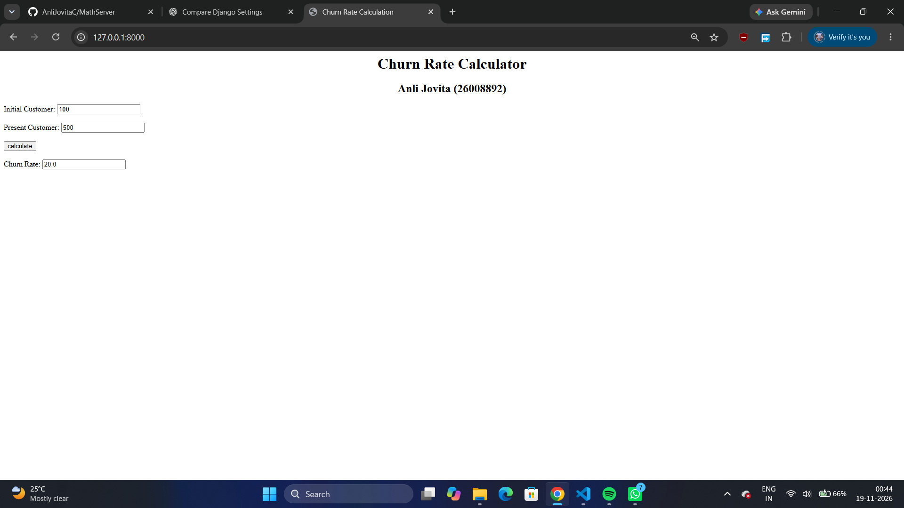

# Ex.03 Design a Website for Server Side Processing
## Date:10 November 2026

## AIM:
To create a web page to calculate Churn Rate using server-side scripts.

## FORMULA:
Churn Rate = (CustLost / InitCust) * 100
<br> InitCust --> Initial Customers Count
<br> CustLost --> Customers Lost Count

## DESIGN STEPS:

### Step 1:
Clone the repository from GitHub.

### Step 2:
Create Django Admin project.

### Step 3:
Create a New App under the Django Admin project.

### Step 4:
Create a HTML file to implement form based input and output.

### Step 5:
Create python programs for views and urls to perform server side processing.

### Step 6:
Receive input values from the form using request.POST.get().

### Step 7:
Calculate the Result using the given formula.

### Step 8:
Display the calculated result in the server console.

### Step 9:
Render the result to the HTML template.

### Step 10:
Publish the website in Localhost.

## PROGRAM:
```
cal_churn.html

<html>
    <head> 
    <title>Churn Rate Calculation</title>
    </head>
    <body>
        <h1 align="center">Churn Rate Calculator</h1>
        <h2 align="center">Anli Jovita (26008892)</h2>
        <form method="POST">
                
                
            <lable>Initial Customer:</lable>
            <input type="number" name="Initial_Customer" value="{{initial_cust}}" ><br><br>
            <label>Present Customer:</label>
            <input type="number"  name="Present_Customer" value="{{present_cust}}"><br><br>
            <input type="submit" value="calculate"><br><br>
            <lable>Churn Rate:</lable>
            <input type="number" value="{{churn_rate}}">
        </form>
    </body>
</html>

views.py

from django.shortcuts import render

def Calculate_Churn_Rate(request):
    
        initial_cust=int(request.POST.get("Initial_Customer",'0'))
        present_cust=int(request.POST.get("Present_Customer",'0'))
        churn_rate=(initial_cust/present_cust*100)if request.method=='POST' else 0
        print("Initial_Customer=",initial_cust)
        print("Present_Customer=",present_cust)
        print("Churn Rate=", churn_rate)

        return render(request, "Anliapp/cal_churn.html",{"initial_cust": initial_cust, "present_cust": present_cust, "churn_rate": churn_rate})


urls.py

from django.contrib import admin
from django.urls import path
from Anliapp import views

urlpatterns=[path('',views.Calculate_Churn_Rate,name='Calculate_Churn_Rate'),]
 
```
## OUTPUT - SERVER SIDE:


## OUTPUT - WEBPAGE:


## RESULT:
The the web page to calculate Churn Rate using server-side scripts is created successfully.
